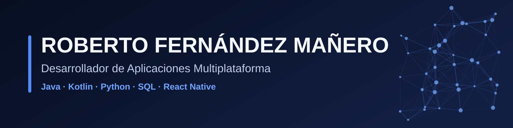

# Hola, soy Roberto Fernández Mañero

**Desarrollador de aplicaciones multiplataforma** (Java, Kotlin, Python, SQL) y **Técnico en Sistemas Microinformáticos y Redes**. Curso 2.º de DAM en el IES Laguna de Tollón y busco **FCT / FP Dual en Sevilla**, preferiblemente en consultoría y desarrollo de software.

## Stack

## Proyectos destacados

### [Panteón RPG](https://github.com/RoberFdez06/Panteon_rpg)
Videojuego de escritorio roguelike por turnos, en **Java Swing** con arquitectura **MVC**, persistencia de partidas con **JDBC** y base de datos relacional, ficheros de texto para los epitafios y patrón Singleton. Incluye capturas, modelo de datos, guía de instalación y hoja de ruta.

### [Poké Chronicles](https://github.com/RoberFdez06/Poke-Chronicles)
Roguelike cenital en el navegador al estilo The Binding of Isaac, hecho con **Phaser 3, Vite y TypeScript**. Generación de pisos, varios modos de juego, progreso con cuentas opcionales (Firebase), pruebas de la lógica con `node --test` y e2e con Playwright, y documentación de diseño.

## Experiencia

- **Prácticas de Desarrollo de Aplicaciones Multiplataforma (Nexoneural S.L., 2026):** páginas web con WordPress y desarrollo de un chatbot, con apoyo de IA.
- **Prácticas de Sistemas Microinformáticos y Redes (Millenium, 2025):** mantenimiento de equipos, resolución de averías y aplicaciones web con WordPress.

## Cómo trabajo

- Separo responsabilidades (MVC, datos y reglas aparte de la interfaz).
- Documento cada proyecto: README, instalación, arquitectura y hoja de ruta.
- Pruebo la lógica y uso Git en el día a día.

## Contacto

